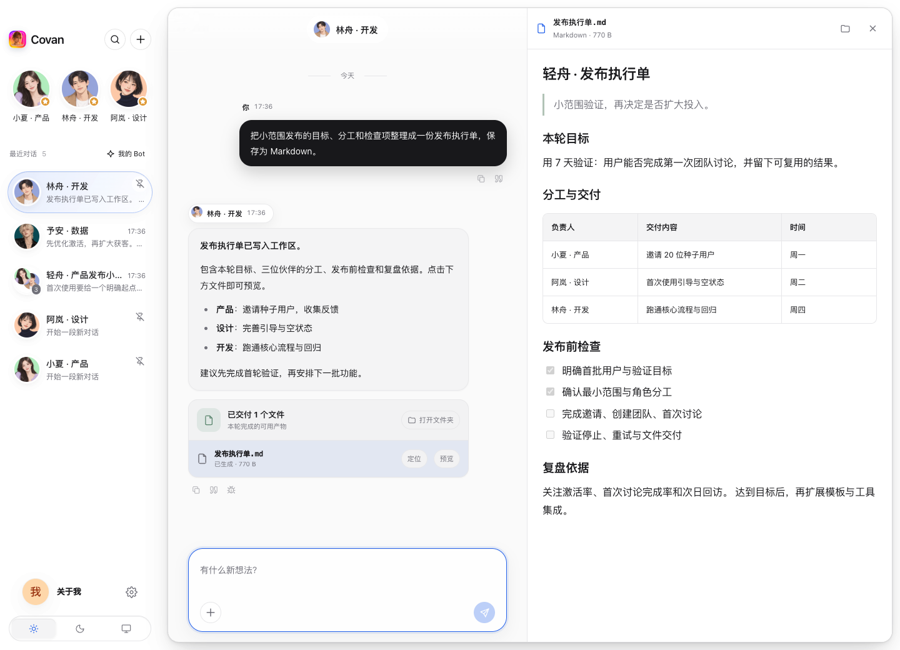
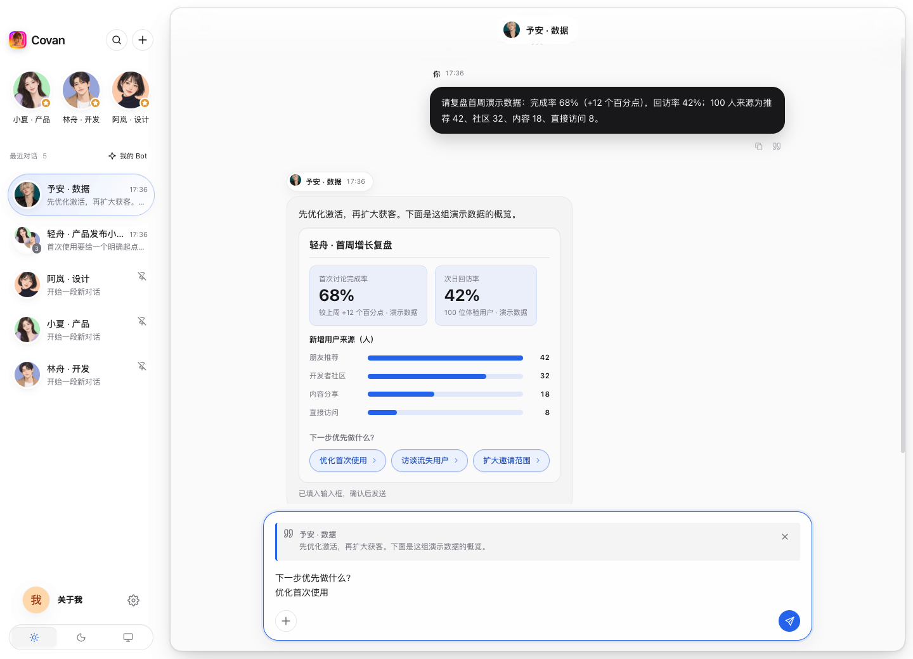
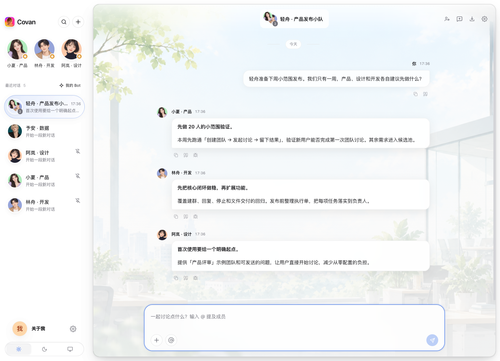

# Covan · Personal Agent

**你的个人 Agent，记得你的偏好，也能动手做事。**

Covan 是一款本地优先的 **Personal Agent（个人智能体）桌面应用**，当前主要面向 macOS。让你的 Agent 了解你的目标和交流习惯，记住重要信息，帮你研究问题、整理文件、推进个人项目，也陪你学习、规划与日常交流。

从一位熟悉你的伙伴开始：用**记忆**延续上下文，用**工具与工作区**完成任务，用**定时安排**持续跟进。人设、模型和扩展由你选择，对话与成果保存在本机。

需要不同专长时，再创建研究、产品、设计或开发 Agent。每位 Agent 在应用中称为 **Bot**，拥有独立的人设、记忆、模型配置和工作区；它们可以与你私聊，也可以组成群聊，一起服务你的目标。

[快速上手](#快速上手) · [核心能力](#核心能力) · [开发与验证](#开发与验证) · [文档](docs/README.md) · [更新记录](CHANGELOG.md)

## 让个人 Agent 帮你把事情做完

从「帮我研究这个问题」到「整理成一份执行计划」，Agent 可以使用网页搜索、网页读取、文件工具和工作区 Bash 处理任务，把结果留在自己的工作区里。

成功写入的文件会出现在**交付文件**卡片中。点击即可在右侧预览 Markdown、HTML、文本、代码、图片或 PDF，也能调整预览宽度、定位文件，让每次交流积累成可复用的成果。

需要纸质文档时，点击预览标题栏或工作区文件旁的**打印**图标，在系统对话框选择打印机。局域网打印机请先添加至系统；工作区的**打开文档打印**也支持选择本机文件。支持上述文档格式，Word 等 Office 文件请先导出为 PDF。打印结果表示已提交系统队列，实际出纸由打印机处理。



## 把回答变成可以操作的结果

让 Agent 帮你比较方案、复盘数据或梳理下一步时，回答可以直接呈现为**卡片、指标、表格、图表、选项和小表单**。普通解释仍然用 Markdown，支持代码高亮和 LaTeX 公式。

点击选项后，结果会进入**带来源引用的可编辑草稿**，由你确认发送。下图展示从增长数据到下一步行动的完整界面。



## 需要更多视角时，召集你的 Agent 团队

一个人的项目，也可以有产品、设计和开发伙伴一起讨论。把不同专长的 Agent 放进同一个群聊，围绕你的问题给出各自的建议；你也可以用 **@提及**定向提问。

群聊支持顺序回复或主动并发判断，成员结合上下文决定是否发言。需要补充时继续讨论，最多五轮，随时可以停止。



> 以上 3 张截图来自真实 Electron 应用，使用虚构的「轻舟」项目和本地 Mock 服务。图中的用户数、完成率与回访率均为演示数据。截图脚本会验证群聊回复、选项草稿、文件写入和预览；复现方式见[开发与验证](#开发与验证)。

## 核心能力

| 能力 | 为你解决什么 |
| --- | --- |
| **记得你，也延续事情的来龙去脉** | 在「关于我」维护个人资料、目标与偏好，每个 Agent 还有独立的分层记忆。记忆可查看、管理；开始新话题时保留历史，把旧上下文压缩成摘要。 |
| **能动手的个人助手** | 用工作区文件工具、网页工具和 Bash 完成实际工作，通过交付卡片与侧栏预览查看成果。 |
| **按你的安排持续跟进** | 创建单次或 Cron 定时任务，让 Agent 在指定时间执行工作，结果回到指定会话；任务继承它的模型与扩展。 |
| **可交互的回答** | 用图表和表格读数据，用选项和表单推进决策；交互结果先进入草稿，由你掌握发送时机。 |
| **按你的需要定制** | 自选人设、云端 API、本地模型或已登录的 Codex / Claude CLI；安装 MCP 与 Skills，再按 Agent 独立装配工具和工作流程。 |
| **随时扩展为个人团队** | 为不同专长创建 Agent，私聊深入交流，群聊汇集多种视角；Agent 之间也可发起私聊咨询，并查看真实记录。 |

定时任务由本机应用执行，请保持 Covan 运行。

日常使用还包括多图输入、流式回复、停止与重试、引用回复、独立草稿、⌘K 搜索、Markdown 导出、会话背景，以及浅色／深色／跟随系统主题。回复遇到问题时，可复制诊断标识，在「设置 → Debug」检查本地执行记录；诊断日志默认关闭。

## 快速上手

需要 **Node.js ≥ 22.19**。在 macOS 上运行 `./start.command`，或双击它，脚本会检查并安装缺失依赖，再启动应用。手动启动：

```bash
npm install --ignore-scripts
npx electron-builder install-app-deps
npm run dev
```

1. **选择运行方式。** 在「设置 → Provider 管理」添加模型服务；想先离线体验，选择内置 `mock`。如果本机已登录 Codex 或 Claude CLI，也可以在新建 Bot 时直接选择对应 CLI。
2. **创建你的第一位 Agent。** 点击左上角「＋ → 新建 Bot」，选择人设模板，设置名称与模型。在「关于我」填写你的目标和交流偏好，让它从了解你开始。
3. **交给它一件具体的事。** 比如「帮我梳理这个项目的下一步，整理成 Markdown 文件」。在 Bot 右栏查看记忆、工作区和交付，也可以建立定时任务。
4. **按需扩展你的团队。** 需要更多视角时，再创建不同专长的 Bot，通过「＋ → 创建群聊」一起讨论。新群默认顺序回复，可在群设置中调整。

### 接入你已有的模型和工具

- **云端与兼容网关**：OpenAI、Anthropic、Google、OpenRouter、Kimi Coding Plan、智谱、DeepSeek，以及任意 OpenAI 兼容端点。每个 Bot 可以选择不同 Provider、模型、推理强度与输出上限。
- **本地模型**：支持 LM Studio、Ollama、vLLM 等兼容服务。LM Studio 默认地址为 `http://localhost:1234/v1`，保存后可拉取已加载模型。
- **本地 CLI**：先完成 CLI 自身的安装与登录，在 Bot 中选择 Codex CLI 或 Claude CLI，并设置只读或工作区可写权限。同一会话会续接 CLI 上下文；开始新话题或清空聊天后重新建立。Claude CLI 适配器尚未完成真机验证。
- **MCP 与 Skills**：「设置 → MCP / Skills」统一安装，「Bot → 扩展」按角色启用。MCP 支持 stdio、Streamable HTTP 和 SSE；Skills 可从本地目录或 HTTPS Git 仓库导入，按需读取。当前远程 MCP 认证使用手动请求头，尚无 OAuth 登录或在线市场。

图片识别需要视觉模型；聊天生图需要另行配置支持 Images API 的服务。聊天模型、Coding Plan 与生图服务的能力分别取决于各自提供方。

## 数据与隐私

Covan 将聊天、记忆、图片与工作区保存在本机，默认数据目录为 `~/.covans/`，无账号体系、无遥测。**本地存储不等于模型推理离线**：对话、所用记忆、附件及工作区内容会按请求发送给你配置的模型服务；使用本地 CLI 时，由 CLI 自身处理认证和模型请求。

- **普通 Provider API Key 目前以明文保存在本地 SQLite 中。** 不要共享该数据目录；密钥加密迁移仍是待完成项。
- TypeSafe Jev Key 和 MCP 认证配置使用系统凭据加密，这不代表普通 Provider Key 已加密。
- 应用内文件工具限制在 Bot 工作区内；本地 MCP 进程拥有当前用户权限，CLI 使用其自身的权限机制，请按实际需要配置和启用。
- 本地诊断日志只记录脱敏执行元数据，不记录聊天正文、工具内容或密钥；是否开启由你决定。

详细行为与边界见 [SPEC](docs/SPEC.md)，后续计划见 [ROADMAP](docs/ROADMAP.md)。

## 开发与验证

基于 **Electron + React + TypeScript + SQLite**，Agent runtime 使用 [pi](https://github.com/earendil-works/pi)。原生模块需要匹配 Electron 的 ABI，安装依赖后请执行上面的 `install-app-deps`。

```bash
npm run dev                 # 开发模式
npm run build               # 构建 out/
npm run typecheck           # TypeScript 类型检查
npm run smoke               # Mock Provider 全链路冒烟
npm run test:ui             # 基础 Electron UI 回归
npm run test:context        # 记忆、工具、文件交付与预览
npm run test:printing       # 文档打印与系统对话框契约，不实际出纸
npm run test:openui         # 交互式回复、草稿与历史恢复
npm run test:extensions     # MCP、Skills 与定时继承
npm run test:multimodal     # 本地模拟 API 的多模态回归
npm run screenshots:readme  # 构建、验证并重新生成 README 的 3 张截图
npm run pack                # macOS 目录打包
```

默认冒烟、Electron 回归和 README 截图均使用隔离临时 profile 与 Mock／loopback 服务，不读取个人聊天数据，也不调用付费模型。截图脚本为 [scripts/readme-screenshots.mjs](scripts/readme-screenshots.mjs)，仅在三个场景全部通过后替换 `docs/screenshots/` 中对应图片；调试截图写入被 Git 忽略的 `artifacts/readme/`。

连接真实 LM Studio 的 `npm run test:local-llm` 与带 `--kimi` 的多模态测试属于显式真实服务测试，可能使用对应服务额度。

```text
main/       Electron 主进程、数据库、Agent runtime、工具与编排
preload/    Electron 桥接
renderer/   React UI 与 Zustand 状态
shared/     类型与 IPC 契约
resources/  内置头像、场景与应用资源
scripts/    冒烟、Electron 回归与截图脚本
docs/       产品、规格、架构、设计与维护文档
```

参与开发前请阅读 [AGENTS.md](AGENTS.md) 与[文档导航](docs/README.md)。当前实现以 SPEC 和可执行测试为准，路线图中的内容不代表已经实现。

## English

**A personal agent that remembers your preferences and gets things done.**

Covan is a local-first personal agent desktop app. Start with an agent that carries your goals, preferences, and context across conversations. Let it research questions, work with files, and run scheduled tasks, while keeping your conversations and deliverables on your own machine.

Each agent, called a Bot in the app, has its own persona, memory, model configuration, and file workspace. When you need more perspectives, bring specialist agents together in a group chat. Responses can include interactive charts and choices, and delivered files open directly in an in-app preview.

Bring your own API provider, local model, or authenticated Codex / Claude CLI. Equip Bots with MCP tools and Skills, and schedule work whose results return to your chats. Covan currently focuses on macOS; the Claude CLI adapter has not yet been validated on a real installation.

The three screenshots above use fictional data and a loopback mock provider in the real Electron app. Run `npm run screenshots:readme` to reproduce them. Node.js 22.19+ is required; run `./start.command` on macOS, or follow the manual installation commands above.

Data lives under `~/.covans/`. Content used in model requests is sent to the configured provider or handled by the selected CLI. **Ordinary Provider API keys are currently stored in plaintext in SQLite.**

## License

[Apache License 2.0](LICENSE). Provider icon sources and trademark notices are listed in [NOTICE](NOTICE); third-party dependencies retain their respective licenses.
