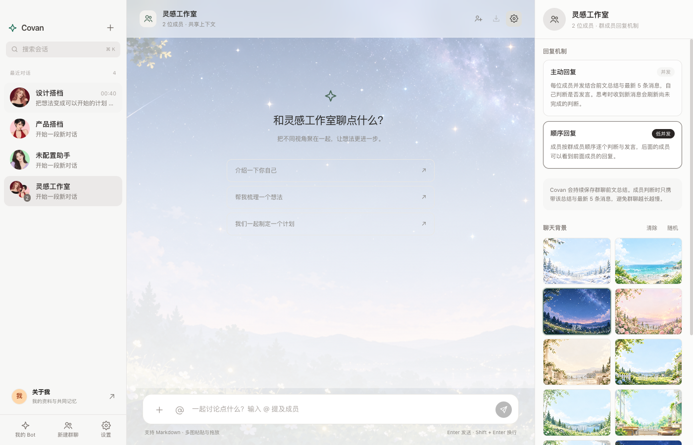
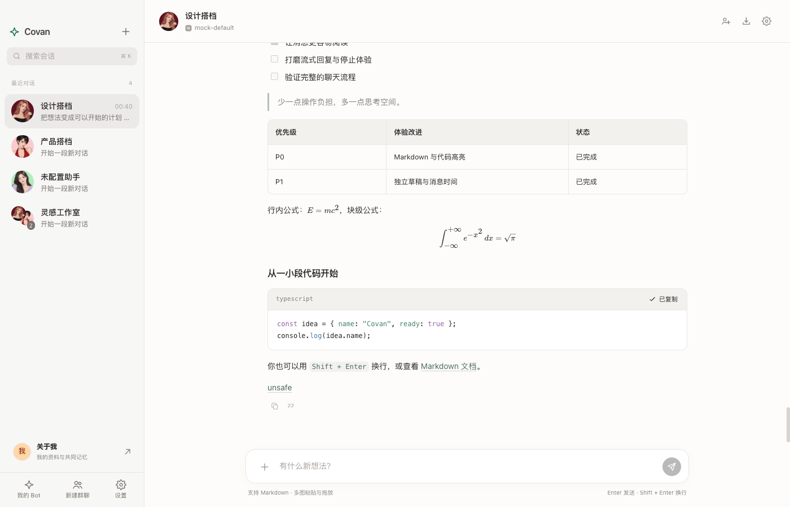
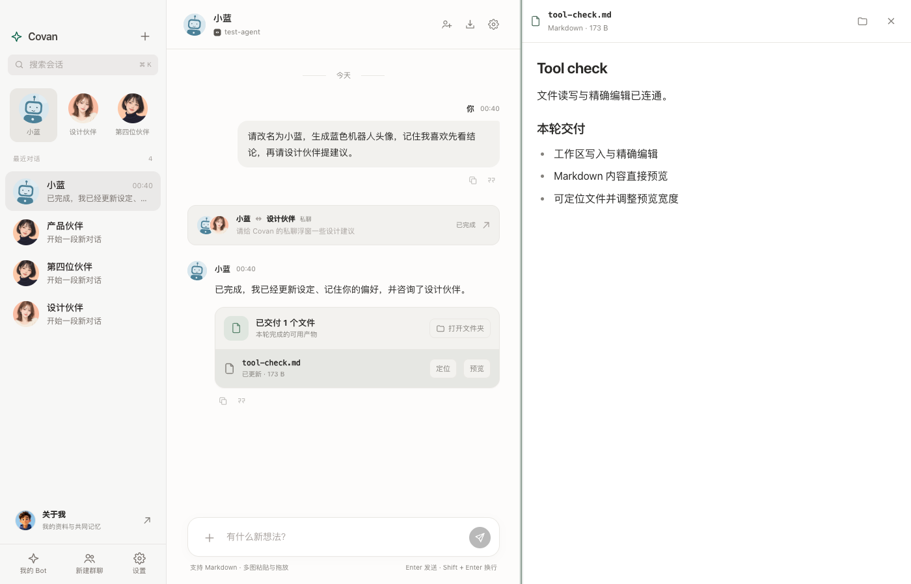

# Covan — 多 Bot 智能体聊天桌面应用

一款 Electron + React 多智能体聊天桌面应用。创建多个拥有独立人设、记忆、模型配置和工作区的 Bot，与它们私聊或发起群聊。适用于**工作协作**（开发、产品、研究）和**日常陪伴**。Agent runtime 基于 [pi（earendil-works/pi-mono）](https://github.com/earendil-works/pi) 的统一 LLM 抽象层。

## 截图 Screenshots



<details>
<summary>更多界面 / More screens</summary>





</details>

## 功能一览

- **多 Bot 管理**：名称/头像/标签/描述/人设 prompt，新 Bot 从内置头像集中自动分配；内置 8 套人设模板（高级全栈、架构设计师、Code Reviewer、测试员、产品经理、设计师、虚拟女友·小美女、自定义）
- **拟人化对话节奏**：私聊可在设置中开启「自然追问」，Bot 只在有补充价值时另发 1–2 条短消息；群聊以首轮为起点按需延展讨论，成员每轮重新判断，最多 5 轮并避免复述
- **新话题与上下文压缩**：单聊和群聊都可保留完整历史并开始新话题；旧上下文先压缩成摘要，后续只携带摘要与新消息，长对话或隔天续聊会主动提醒
- **群聊回复机制**：「主动回复」让全体成员并发判断是否发言，「顺序回复」让成员逐个判断与回复；判断上下文固定为前文总结 + 最新 5 条消息，支持 @提及强制回复
- **可选响应决策引擎**：每个 Bot 默认自动优先使用已配置的 TypeSafe Jev，也可强制传统 LLM 或 Jev；Jev 低置信度或不可用时回退当前 LLM，回复正文仍由 Bot 的生成模型完成
- **独立聊天背景**：新群聊随机分配场景背景；群聊和私聊均可单独更换、随机或清除，不同会话互不影响
- **独立记忆**：每个 Bot 的长期记忆（对话中自动提取 + 手动增删），下次对话自动注入 system prompt
- **独立工作区与网页工具**：每个 Bot 一个文件目录，Agent 可分页读取、覆盖写入、精确编辑、列目录，也可搜索和读取网页；网页请求继承系统代理并兼容 Fake-IP，动态页会自动用隐藏 Chromium 执行 JavaScript
- **产物预览**：工作区交付文件在右侧预览 Markdown、HTML、TXT、代码、图片和 PDF；拖动边缘调整预览宽度，也可定位文件或打开工作区
- **定时 Agent 任务**：每个 Bot 可在右侧「定时」页建立单次或 Cron 重复任务；默认继承 Bot 模型，也可为任务覆盖模型。完成结果自动发回目标会话，并可从「设置 → 定时任务」统一查看、暂停、立即执行或删除；也可以直接用自然语言让 Bot 设置自己的任务
- **多 LLM Provider**：OpenAI / Anthropic / Google / OpenRouter / Kimi Coding Plan / 智谱 / DeepSeek / LM Studio / 任意 OpenAI 兼容端点（Ollama、vLLM、公司网关）/ 内置 Mock（离线体验）；每 Bot 可绑定不同 provider 与模型
- **MCP 与 Skills**：在「设置 → MCP」或「设置 → Skills」分别安装 MCP 服务和导入技能，在 Bot 右栏「扩展」独立装配；定时任务继承同一配置，也能用自然语言让 Bot 装配已安装的扩展。
- **流式输出 / 随时停止 / 错误重试**；主题跟随系统（浅色/深色）
- **回复诊断**：回复旁 Bug 按钮复制诊断标识，在「设置 → Debug」加载对应执行记录，选择 Bot 模型分析原因。日志默认关闭，开启后记录后续执行；分析只发送诊断元数据，不发送聊天正文、工具内容或密钥。
- **Markdown 阅读体验**：表格、任务列表、行内/块级 LaTeX 公式、代码高亮与代码复制；消息时间与日期分隔；引用回复
- **聊天效率**：独立持久草稿、中文输入法保护、⌘K 搜索、会话恢复、完整 Markdown 导出；群聊停止会取消后续成员发言，左侧群聊右键可确认删除
- **关于我**：个人资料、头像、交流偏好、目标与边界；可编辑/删除的共同记忆，显示记录来源，供所有 Bot 的后续对话使用
- **自然语言设定与双模式头像**：Agent 可通过实际工具修改名称、人设、emoji；按人设扩写提示词；本地 SVG 插画或配置 Images API 生成图片头像
- **Agent 私聊**：Bot 向另一位 Bot 咨询，消息流中插入私聊卡片，点击浮窗查看真实记录、状态与时间；支持停止，不递归发起私聊
- **最多 3 个置顶 Bot**：在左侧单聊列表项右键 → 置顶/取消置顶；顶部只显示已置顶头像，没有空槽位

产品、规格、架构与设计文档见 [文档导航](docs/README.md)；版本变化见 [CHANGELOG](CHANGELOG.md)。本项目使用 [Apache License 2.0](LICENSE)。Provider 图标随应用本地打包，来源与商标说明见 [NOTICE](NOTICE)。

## 运行

要求 Node.js >= 22.19。macOS 可双击仓库根目录的 `start.command`，或运行 `./start.command`；脚本会检查并安装缺失依赖，再启动应用。Electron 使用自己的内置 Node，原生模块需要匹配 Electron ABI。

```bash
# 要求 Node >= 22.19（pi 包 engines 约束；Electron 38 内置 Node 22）
npm install --ignore-scripts   # pi 官方推荐；better-sqlite3 需随后重建
npx electron-builder install-app-deps  # 为 Electron 构建原生依赖

npm run dev      # 开发模式（electron-vite dev，热更新）
npm run build    # 构建 out/
npm run typecheck # TypeScript 类型检查
npm run smoke    # 使用 Electron 的 Node 模式验证 Mock Provider 全链路
npm run test:ui  # 构建并运行独立临时 profile 的真实 Electron 点击回归
npm run test:context # 记忆、背景、Agent 工具、产物预览等真实 Electron 回归
npm run test:extensions # MCP 三种传输、Skill 安装与隔离、Bot 装配和定时继承
npm run test:avatars # 头像和资料页的真实 Electron 回归
npm run test:multimodal # 多模态输入的本地模拟回归
npm run test:local-llm # 可选：连接 localhost:1234 的真实 LM Studio 模型
```

Electron UI 回归截图写入 `artifacts/`，测试使用隔离临时 profile 和本地 mock，不读取个人聊天记录或调用付费模型。真实服务测试 `node scripts/multimodal-ui.mjs --kimi` 会使用已有 Kimi 配置并消耗服务额度。

> 开发模式下 Electron 加载 better-sqlite3 需要的是 **Electron 的 ABI** 构建。若 `npm run dev` 报原生模块 ABI 错误，执行：
> `npx electron-rebuild -f -w better-sqlite3`（或 `npm install electron-rebuild -D` 后运行）。

## 打包

```bash
npm run pack     # electron-builder --mac --dir（产物在 release/）
```

打包注意：pi 包为 **ESM only**，若单文件构建出现 `Dynamic require of "child_process" is not supported`，需在 esbuild 加 banner 注入 `createRequire` shim（详见 [架构文档](docs/ARCHITECTURE.md#10-打包与分发)）。

## 快速上手

1. 启动后点左下角齿轮 → **Provider 管理** → 新增（填入 API Key；Kimi Coding Plan 保存后点击「拉取模型」选择账号可用模型；想离线体验选 `mock` 类型）
2. 左上「+」→ **新建 Bot** → 选人设模板（如「虚拟女友·小美女」或「高级全栈」）→ 创建后自动进入单聊
3. 左上「+」→ **创建群聊** → 勾选多个 Bot；新群默认使用顺序回复，可在群聊右上角齿轮中切换为主动回复
4. 右侧面板管理该 Bot 的**设定 / 记忆 / 工作区 / 定时 / 模型 / 扩展**；在「模型」中可选自动、传统 LLM 或 Jev 响应决策；在「定时」中创建单次或重复任务，在「设置 → 定时任务」查看全部任务；在「设置 → Bot」可开关私聊的**自然追问**并配置 Jev
5. 左侧 **关于我** 填写资料，或在聊天中说「请记住，我喜欢先看结论」；共同记忆可随时编辑/删除
6. 右键单聊列表项 **置顶**，最多 3 位；同一菜单 **取消置顶**
7. 点击 Bot 设置中的头像 → **设计头像**。本地插画立即可用；**设置 → 头像生成** 选择支持 Images API 的 Provider 与模型后，才能使用 AI 生图。Coding Plan 不等于生图服务
8. 对 Bot 说「改名为小蓝，生成蓝色机器人头像」或「和设计师讨论一下方案」；也可点聊天顶部的双人图标发起咨询。私聊卡片点击后显示浮窗

LM Studio：Provider 类型选 **LM Studio**，无需 API Key，点 **拉取模型** 后选择已加载实例。Base URL 默认是 `http://localhost:1234/v1`；若误贴 `/api/v1/chat` 或 `/v1/chat/completions`，保存时会自动规范成 `/v1`。Covan 需要自定义工具，所以使用 LM Studio 的 OpenAI 兼容 Chat Completions 入口。每个 Bot 可独立选择关闭/低/中/高/极高推理强度，并设置最大输出 Token；新建 Bot 默认使用中等推理和 8192 输出 Token，已有 Bot 保留原设置。第三方模型未声明标准推理能力时，Covan 会加入兼容提示；简短聊天可按成本需要调低。

### Jev 响应决策 / Jev response decisions

在 **设置 → Bot** 保存 TypeSafe API Key、选择 `jev-latest`（或固定版本）并设置置信度阈值。Bot 默认使用「自动」策略：Jev 已配置时优先使用，也可在 **Bot → 模型 → 响应决策策略** 强制选择传统 LLM 或 Jev。Covan 只把决策所需的 Bot 身份、会话摘要和最近 5 条消息发送给 TypeSafe；Jev 返回结构化 `reply|skip`，不会生成聊天正文。低置信度、未配置、超时或服务失败会回退 Bot 当前 LLM。TypeSafe Key 使用系统凭据加密，普通 Provider Key 的既有存储方式不变。模型行为与版本以 [TypeSafe Jev 文档](https://docs.typesafe.ai/introduction) 为准。

Configure the TypeSafe key, Jev model, and confidence threshold under **Settings → Bot**. The default automatic strategy prefers Jev when configured; each Bot can still force the traditional LLM or Jev under **Bot → Model → Response decision strategy**. Jev decides whether to reply or continue; the Bot's regular provider still generates the actual message. Low-confidence and failed Jev calls fall back to the existing LLM strategy.

生图使用 [Images API](https://developers.openai.com/api/reference/resources/images/methods/generate) 的 `POST /images/generations`，兼容 base64 或图片 URL 响应；不预置或猜测生图模型。自动模式未配置服务时使用本地 SVG，显式选择 AI 生图时配置不足会显示错误。生图最多等待 120 秒、下载限制 16MB。调用会消耗所选服务额度，API 兼容性需以该服务文档为准。

## MCP 与 Skills

1. 打开 **设置 → MCP → 安装**，选择本地 stdio 命令、Streamable HTTP 或 SSE，填写名称与连接配置。参数使用 JSON 数组；环境变量和认证请求头使用 JSON 对象，编辑留空保留、`{}` 清除。保存后点测试图标，可查看服务返回的工具清单。
2. **Skills → 安装** 可选择含 `SKILL.md` 的本地目录，或填写 HTTPS Git 仓库地址及可选子目录。支持导入多个技能，同名重装更新内容并保留装配；不会执行安装脚本或自动安装系统依赖。
3. 打开目标 **Bot 右栏 → 扩展**，分别启用所需 MCP/Skills。每个 Bot 独立配置，新安装的扩展不会自动装配给所有 Bot。也可以对 Bot 说「给你启用已安装的写作技能」，装配修改下一轮生效。

MCP 目前接入工具能力；远程认证使用手动配置的请求头，暂不提供 OAuth 登录、MCP resources/prompts 界面或在线扩展市场。模型通过官方 MCP SDK 工具协议调用服务；Skills 使用 [Agent Skills 格式](https://agentskills.io/specification)，正文与引用按需读取。Skill 脚本通过既有 macOS Bash 沙箱执行，技能包只读、产物写入 Bot 工作区。MCP 子进程具有当前用户权限，只安装信任的服务。

## 聊天图片

- 点输入框左侧「+」、粘贴或拖入图片；每条最多 8 张，每张最多 16MB，支持 PNG、JPEG、WebP、GIF，可只发图片。
- 发送前可预览、移除；双方消息中的图片支持点击放大。图片与草稿保存在本地，重启和重试不丢失；导出 Markdown 会同时导出图片文件夹。
- 视觉模型会收到实际图片内容，而非文件名；聊天历史中的图片也可再次提问。请在 Bot 设置里选择支持视觉的模型。Kimi `k3` 的温度按服务要求固定为 1。
- 对 Agent 说「帮我画一张图」可调用 `generate_image`，使用 **设置 → 头像生成** 中配置的 Images API 服务，结果直接附在聊天回复里，不替换头像。每轮最多 4 张，支持停止；服务未配置时会报错，不会伪造成功。此工具目前是文生图，不是图像编辑。
- 看图与生图是独立能力：Kimi Coding Plan 的识图不代表它提供 Images API。聊天模型直接返回的 Markdown 图片链接同样可内嵌查看。
- 附件随消息发送到当前 Bot 的模型服务；群聊会发送给参与回复的 Bot。草稿保存在本地，不会因为预览就上传给模型。

验证：`npm run test:multimodal` 使用本地模拟 API；`node scripts/multimodal-ui.mjs --kimi` 使用现有 Kimi 配置和实时拉取的 `k3` 做真实双图识别（消耗额度），测试会话使用独立临时目录。

## 目录结构

```
main/       Electron 主进程（db / agentRuntime / orchestrator / memory / workspace / ipc）
preload/    contextBridge 安全桥（window.covan）
renderer/   React 三栏 UI（stores / components / lib）
shared/     主↔渲染共享类型与 IPC 通道常量（接口契约）
resources/  随应用分发的头像、生活照与群聊场景图
scripts/    冒烟测试与真实 Electron UI 回归
docs/       PRD / SPEC / 架构 / 设计 / 路线图 / Bugfix 记录
LICENSE     Apache License 2.0
AGENTS.md   AI 开发入口、文档权威顺序与工作流
CHANGELOG.md  面向用户的版本变化
```

## 隐私与安全

- 本机数据根目录默认为 `~/.covans/`：`covan.db`、`avatars/`、`chat-images/` 与每个 Bot 的 `workspaces/<botId>/` 都在这里；首次启动自动创建。若此前使用旧默认目录且 `~/.covans/` 尚不存在，会安全复制旧数据，旧目录不会删除。无遥测；聊天内容、使用到的工作区内容、个人资料与共同记忆会发送给对应模型服务，头像提示词会发送给所选生图服务
- ⚠️ API Key 当前以**明文**存于本地 SQLite，请勿与他人共享该目录；safeStorage 加密已列入 [ROADMAP](docs/ROADMAP.md#provider-密钥保护)
- MCP 环境变量/认证请求头单独使用系统 `safeStorage` 加密，列表仅返回键名，系统加密不可用时拒绝保存；这不代表现有 Provider API Key 已加密。启用的 MCP 会收到模型发起的工具参数，Skill 正文及所读内容会进入所选模型上下文；本地观测日志只保存脱敏元数据。
- 工作区文件工具通过词法路径 + realpath 校验拒绝绝对路径、`..` 和符号链接逃逸；网页工具不携带登录态，限制超时、响应大小和内容类型，当前不拦截内网地址；应用工具不向模型返回 Provider 密钥
- 私聊仅转发咨询问题，不自动转发主会话；接收方只开放工作区读取/列表工具，禁止修改资料和递归私聊。每轮最多 3 次咨询，每个主会话最多同时运行 3 个

## English

Covan is an Electron + React desktop chat app for working with multiple AI agents. Each Bot has its own persona, memory, model settings, and workspace. Chat privately or bring Bots together in a group.

### Highlights

- Group chats support parallel or sequential replies, mentions, and bounded follow-up rounds.
- Private and group chats can start a new topic without deleting history. Covan compresses prior context into a carry-forward summary and only sends post-boundary messages afterward.
- Each chat can have its own background. New groups receive a random scene; users can change, randomize, or clear backgrounds per chat.
- Agents can work with files inside their own workspaces and search or read public web pages.
- Delivery cards open a resizable right-side preview for Markdown, HTML, TXT, source code, images, and PDF files.
- Each Bot can run persistent one-time or Cron scheduled tasks. Results are delivered back to the chosen chat; tasks inherit the Bot model unless explicitly overridden.
- Install stdio/Streamable HTTP/SSE MCP servers and local or HTTPS Git Skills in the top-level **Settings → MCP / Skills** pages, then equip each Bot independently in its **Extensions** tab. Scheduled tasks inherit the same setup. Skills load on demand; MCP credentials are encrypted, while existing Provider keys remain plaintext. OAuth and an online marketplace are not included.
- Includes layered memory, streaming responses, Markdown and LaTeX rendering, image attachments, and Agent-to-Agent consultation.
- Copy a reply's diagnostic reference with its Bug button, then inspect execution events and request model-assisted analysis in Settings → Debug. Local logging is opt-in; analysis excludes chat text, tool contents, and credentials.
- Supports OpenAI, Anthropic, Google, OpenRouter, Kimi, Zhipu, DeepSeek, LM Studio, OpenAI-compatible endpoints, and an offline mock provider.

### Quick start

Requirements: Node.js 22.19 or newer. On macOS, run `./start.command` to check dependencies and launch the desktop app. For development:

```bash
npm install --ignore-scripts
npx electron-builder install-app-deps
npm run dev
```

Run `npm run typecheck`, `npm run smoke`, `npm run test:ui`, and `npm run test:context` for local checks. Electron UI tests use isolated temporary profiles and mock services; screenshots are written to `artifacts/`.

### Privacy and license

Application data is stored locally under `~/.covans/`. Chat content and files sent to a model are processed by the provider configured for that Bot. Provider API keys are currently stored in plaintext in the local SQLite database; do not share that data directory.

This project is licensed under the [Apache License 2.0](LICENSE). Provider icon sources and trademark notices are listed in [NOTICE](NOTICE). Third-party dependencies remain under their respective licenses. See the [documentation index](docs/README.md) and [changelog](CHANGELOG.md) for more details.
